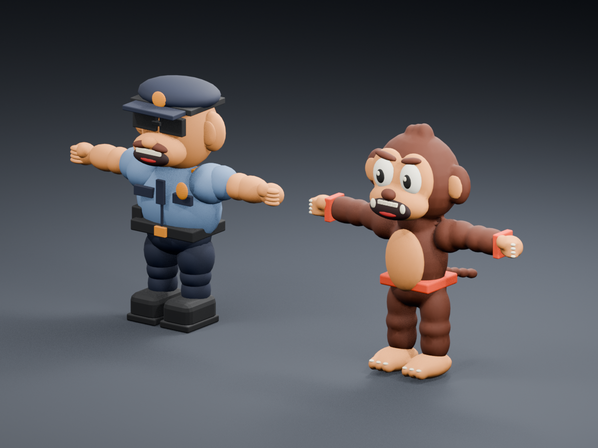
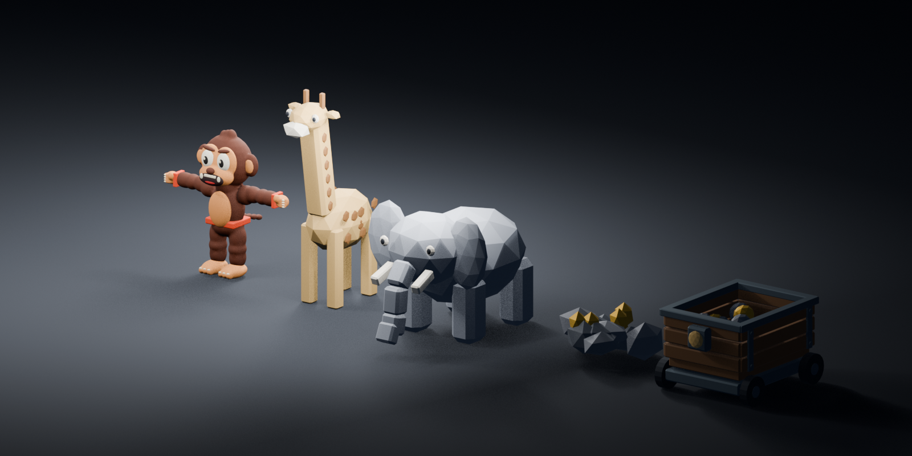
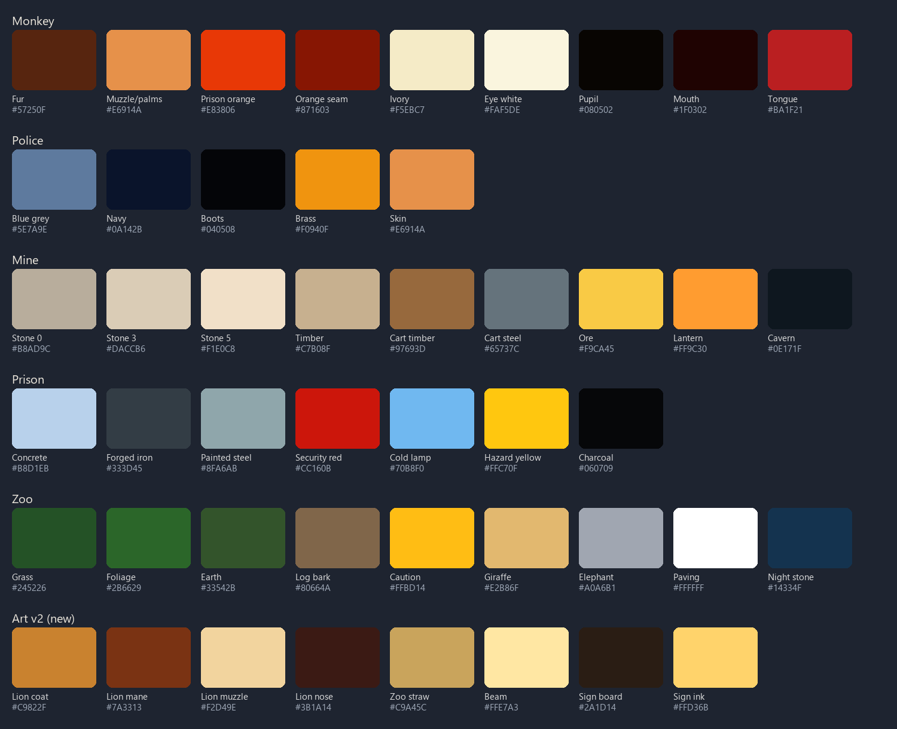

# 아트 스타일 가이드 (2차 에셋 기준)

기준일: 2026-11-26. 기준 브랜치 `release/1.1.0`. 지금 게임에 들어간 자체 Blender 에셋을 측정해서 정리했다. 새 에셋은 이 문서의 값 안에서 만든다. 큰 방향은 [아트 작업 기준](ART_DIRECTION.md)을 따른다.

- 측정 도구: [`analyze_art_style.py`](../Tools/AssetPipeline/analyze_art_style.py) (`.blend`의 삼각형 수·크기·재질·뼈), Unity 재질 값은 `Unity/Assets/Game/Content/ArtV2/Materials/*.mat`의 `_BaseColor`.
- 기준 이미지: [`render_style_reference.py`](../Tools/AssetPipeline/render_style_reference.py) → `docs/images/style/`
- 공용 제작 도구: [`mong_art_common.py`](../Tools/AssetPipeline/mong_art_common.py) (색, 도형, 스튜디오 조명, 렌더, FBX 내보내기)

| 기준 이미지 | 내용 |
| --- | --- |
|  | 원숭이·경찰, 3/4 (정면 `characters_front.png`, 옆 `characters_side.png`) |
|  | 원숭이 옆에 둔 소품: 기린·코끼리·광석 더미·수레 (실제 크기) |
|  | 색상표 (게임 안 색, sRGB) |

## 1. 한 줄 요약

**둥근 덩어리를 붙여 만든 귀여운 캐릭터 + 모서리를 살짝 깎은 각진 소품·환경.** 텍스처 그림 없이 단색 재질, 외곽선 없음, 따뜻한 조명과 블룸으로 분위기를 낸다. 머리가 크고(키의 약 37%), 손발이 크고, 다리가 짧다.

## 2. 색상표

모든 HEX는 **게임 화면에서 보이는 색**(Unity 재질 `_BaseColor`, sRGB)이다.

### 2-1. 캐릭터 (Unity `ArtV2/Materials/Blender_*.mat`, URP/Lit, Smoothness 0.22, Metallic 0)

| 용도 | HEX | 비고 |
| --- | --- | --- |
| 원숭이 털 | `#57250F` | 몸 전체. 가장 넓은 면 |
| 원숭이 얼굴·손바닥·발 (경찰 피부도 같음) | `#E6914A` | 따뜻한 살구색 |
| 죄수 주황 (허리띠·손목) | `#E83806` | 원숭이를 알아보는 표시. **다른 곳에 쓰지 않는다** |
| 주황 솔기 | `#871603` | |
| 경찰 상의 | `#5E7A9E` | |
| 경찰 바지·모자 | `#0A142B` | |
| 신발·선글라스·벨트 | `#040508` | |
| 배지·버클 (Metallic 0.4) | `#F0940F` | |
| 이·발톱 (상아) | `#F5EBC7` | |
| 흰자 / 눈동자 | `#FAF5DE` / `#080502` | 큰 흰자 + 작은 세로 타원 눈동자 + 흰 반짝임 |
| 입 안 / 혀 | `#1F0302` / `#BA1F21` | 입은 항상 살짝 벌린 표정 |

### 2-2. 환경·소품 (Unity `ArtV2/Materials`)

| 맵 | 주요 색 |
| --- | --- |
| 광산 | 돌 `#B8AD9C`~`#F1E0C8` (6단계, HandPaintedTriplanar), 기둥 나무 `#C7B08F`, 수레 나무 `#97693D`, 수레 강철 `#65737C`, 광석 `#F9CA45`(발광), 랜턴 `#FF9C30`(발광), 깊은 어둠 `#0E171F` |
| 감옥 | 콘크리트 `#B8D1EB`(Triplanar), 단조 철 `#333D45`(Metallic 0.48), 도장 강철 `#8FA6AB`(Metallic 0.35), 경보 빨강 `#CC160B`, 차가운 조명 `#70B8F0`(발광) |
| 동물원 (밤) | 잔디 `#245226`, 나뭇잎 `#2B6629`, 흙 `#33542B`, 통나무 `#80664A`, 주의 노랑 `#FFBD14`, 기린 `#E2B86F`, 코끼리 `#A0A6B1`, 젖은 돌 `#14334F` |
| 공통 경고 | 위험 노랑 `#FFC70F`·`#FFDF38`, 레이저/게이트 빨강 `#FF0904` (발광) |

**색 사용 규칙**
- 노랑·빨강 발광색은 위험·경고·수집에만 쓴다. 장식에 쓰지 않는다.
- 죄수 주황 `#E83806`은 원숭이(동료 포함) 전용.
- 넓은 면은 채도를 낮게, 포인트(눈, 배지, 경고판)만 채도를 높게.
- 같은 재질을 새로 만들지 말고 위 Unity 재질을 다시 쓴다(새 FBX의 재질 이름을 기존 재질로 연결, 6장).

### 2-3. 2차 에셋 새 색 (이 문서와 함께 추가)

| 용도 | HEX | 이유 |
| --- | --- | --- |
| 사자 털 | `#C9822F` | 원숭이 털(`#57250F`)보다 밝은 황토. 어두운 동물원 밤에도 실루엣이 보이게 |
| 사자 갈기·꼬리 끝 | `#7A3313` | 원숭이 털과 같은 계열의 붉은 갈색 |
| 사자 주둥이·배 | `#F2D49E` | 원숭이 얼굴과 같은 역할(밝은 얼굴 판) |
| 사자 코 | `#3B1A14` | |
| 동물원 짚 (사자 우리 지붕·바닥) | `#C9A45C` | 통나무·흙과 함께 "동물원"으로 읽히게 하는 밝은 짚색 |
| 동물원 물웅덩이 물 / 물결 / 진흙 둑 | `#2F7393` / `#7FC0D8` / `#4A3423` | 물만 Smoothness 0.6 + 약한 발광 `#3A8FB8`(밤 조명에서 반짝임). 노랑·빨강이 아니라 경고색 규칙과 겹치지 않음 |
| 탐조등 빛 | `#FFE7A3` (반투명, 발광) | 차가운 감옥 조명과 구분되는 따뜻한 빛 = "들키면 안 되는 빛" |
| 간판 판 / 글자·아이콘 | `#2A1D14` / `#FFD36B` | 지금 갈림길 화살표 판(어두운 판 + 밝은 기호)과 같은 대비 |

실제 값 전체는 `Tools/AssetPipeline/art_v2_palette.json`에 모인다(2차 에셋 스크립트가 실행될 때 자동으로 갱신).

## 3. 셰이딩

| 구분 | 방식 |
| --- | --- |
| 캐릭터·동물(원숭이, 경찰, 사자) | **부드러운 셰이딩.** 공·캡슐 도형을 붙인 뒤 voxel remesh(0.022) → Smooth(0.5×3) → Decimate(0.5)로 한 덩어리 피부를 만든다. 눈·이·벨트 같은 부품은 따로 붙인 부드러운 도형 |
| 소품·환경(벽, 수레, 기린·코끼리 장식, 표지판) | **평면(각진) 셰이딩.** 박스에 Bevel(가장 짧은 변의 9~16%, 1~3단)을 줘서 모서리만 둥글게. 돌은 꼭짓점을 ±5cm 흔들어 손으로 깎은 느낌 |
| 텍스처 | 캐릭터·소품은 **텍스처 없음(단색 재질).** 큰 환경 면만 `HandPaintedTriplanar` 셰이더 + 회색 디테일 텍스처(stone/wood/cloth 256px)를 색으로 물들인다. UV 작업 필요 없음 |
| 재질 값 | URP/Lit. Smoothness 0.1~0.35(대부분 0.22), Metallic은 금속에만 0.35~0.5 |
| 발광 | 랜턴·광석·경고등·탐조등. 블룸 임계 0.9라서 발광 색만 번진다 |
| 외곽선 | **없음.** 외곽선 셰이더를 쓰지 않는다. 실루엣과 명암 대비로 읽힌다 |
| 후처리 (`MuhanokVolume`) | ACES 톤매핑, 블룸 0.65, 비네트 0.16, 피사계 심도 |

## 4. 폴리곤 수 (측정값과 범위)

| 구분 | 측정값 (삼각형) | 새 에셋 범위 |
| --- | --- | --- |
| 주인공 캐릭터 | 원숭이 38,192 / 경찰 22,240 | 20k~40k. 사자 25k~35k |
| 동료 원숭이(무리) | 원숭이와 같은 메시 | 같은 메시 재사용 |
| 큰 소품·장식 동물 | 수레 2,996 / 기린 1,288 / 코끼리 1,080 / 1인칭 손 3,248 | 1k~5k |
| 작은 소품 | 광석 더미 300 / 경고판 252 / 아치 396 | 100~1k |
| 환경 조각 | 동굴 벽 1,100 | 1k~3k |
| 청크 한 개(계단) | 7k~8k | 청크당 10k 이하 |

## 5. 비율과 실루엣

| 항목 | 원숭이 | 경찰 |
| --- | --- | --- |
| 키 | 2.25 m (머리털 포함) | 2.18 m (모자 포함) |
| 머리 높이 / 키 | 0.80 m / 37% (약 **1 : 2.7**) | 0.80 m / 37% |
| 엉덩이(골반) 높이 | 0.78 m (키의 35%, 다리가 짧다) | 같음 |
| 팔 길이 (T포즈 손끝 간격) | 2.26 m | 2.27 m |
| 손·발 | 손 주먹 지름 약 0.2 m, 발 길이 0.5 m (과장) | 장화 0.45 m |

**실루엣 규칙**
1. 머리 > 몸통. 머리 지름이 어깨너비와 비슷하거나 크다.
2. 덩어리는 3~4개로 읽힌다(머리 / 몸통 / 다리 / 손발). 가는 부분(손목·발목)은 짧게.
3. 등 뒤에서도 누군지 알아본다: 원숭이 = 꼬리 + 등 번호 판 + 주황 허리띠, 경찰 = 모자 + 파란 상의.
4. 동물은 같은 비율감: 큰 머리, 짧은 다리, 둥근 몸. 사자는 갈기로 머리를 더 크게(머리+갈기 지름 ≈ 몸통 높이).
5. 게임 장애물은 모양으로 동작을 알려 준다: 점프 = 낮고 넓은 것(무릎 높이 0.6~1.0 m), 숙이기 = 머리 위 가로대, 막힘 = 레인 전체.
6. 달리면서 1초 안에 읽혀야 하는 것(간판, 경고)은 단순한 평면 기호 + 큰 글자 1단어, 장식 금지.

## 6. 애니메이션

| 항목 | 기준 (`build_blender_characters.py` 측정) |
| --- | --- |
| 프레임레이트 | 30 fps |
| 루프 길이 | 달리기류 21프레임(0.67초, 한 주기 두 걸음), 그 외 37프레임(1.2초) |
| 키 | 매 프레임 키(구운 동작). 포즈는 사인 곡선으로 부드럽게 오간다 |
| 과장 정도 | 중간 정도 만화: 팔 흔들기 ±34°, 허벅지 ±32°, 무릎 접기 최대 55°, 달리기 상체 숙임 10°, 숙이기 30°, 엉덩이 위아래 2.2 cm, 꼬리 ±10° |
| 루트 | 제자리 동작. 앞으로 나가는 이동은 코드가 한다(Root Motion 없음). 한 번 동작에서 몸이 움직이는 거리(점프 높이, 튀어나옴, 우리 탈출)는 **몸통 뼈 키**(원숭이 `Hips`, 사자 `Spine`)에만 넣고, FBX 루트(`Rig`, 사자 `Root` 뼈)는 원점에 둔다. 동작이 끝난 위치로 오브젝트를 옮기는 것은 코드가 한다 |
| 한 번 동작 | 준비(웅크림) → 동작 → 여운의 3단계, 준비 동작을 크게 보여 준다 |

2차 동작 규칙:
- **튜토리얼 시범 동작은 몸 높이·기울기를 애니메이션 안에 넣는다**(Hips 위치/회전 키). Unity에서 Root Transform Y·회전을 "Bake Into Pose"로 가져오므로 코드 없이 그대로 보인다.
- 사자·소품 동작도 30 fps, 한 번 동작은 0.5~2초. 사자 달리기도 21프레임(원숭이·경찰과 같은 박자).
- 사람형 클립은 Root Transform XZ·Y를 Bake Into Pose로 들여오므로, 이동이 있는 클립(구출 튀어나옴, 감방 탈출)이 끝나면 오브젝트를 끝 위치로 옮기는 것은 코드가 한다. 이어지는 루프가 있으면 마지막 프레임을 그 루프의 한 프레임과 같게 맞춘다(감방 탈출 f054 = `AN_Monkey_Run` f001).
- 원숭이 팔은 어깨 위 50°까지만 올리고 Shoulder 뼈가 그중 최대 22°를 나눠 든다. 그보다 높이면 기존 피부가 어깨·윗등에서 접힌다.
- 추격자·러너는 카메라가 뒤나 앞에 있으므로 검수 렌더에 **뒤(`back`)** 를 꼭 넣는다.

## 7. 이름 규칙

| 접두어 | 뜻 | 예 |
| --- | --- | --- |
| (없음) | 캐릭터 모델 FBX | `Monkey.fbx`, `Police.fbx`, `Lion.fbx` |
| `AN_<캐릭터>_<동작>[_Loop/_L/_R]` | 동작 클립 FBX (뼈만) | `AN_Monkey_Run`, `AN_Lion_Roar` |
| `MD_<맵>_<이름>` | 2차 소품 모델 FBX | `MD_Prison_Searchlight`, `MD_Zoo_Fence` |
| `CHR_` / `CH_` / `OBS_` | Unity 캐릭터 프리팹 / 청크 프리팹 / 장애물 프리팹 | `CHR_Monkey_Prisoner`, `CH_Mine_Start`, `OBS_ZooLowLog` |
| `ArtV2_<묶음>.blend` | 2차 Blender 원본 | `References/Blender/ArtV2_Lion.blend` |
| `build_art_<묶음>.py` | 2차 생성 스크립트 | `Tools/AssetPipeline/build_art_lion.py` |

Blender 안 오브젝트 이름은 영어, 뼈 이름은 Unity Humanoid 이름(`Hips`, `LeftUpperArm` …)을 그대로 쓴다. 재질 이름은 Unity 재질 이름과 같게 짓는다.

## 8. Blender 좌표와 내보내기

- Z 위, 캐릭터·소품은 **-Y를 앞**으로 본다. 1 Blender 단위 = 1 m. 바닥은 z = 0, 피벗은 발 아래 가운데(문·탐조등은 회전축).
- FBX: `axis_forward='-Z'`, `axis_up='Y'`, `add_leaf_bones=False`, `use_armature_deform_only=True`, `mesh_smooth_type='FACE'`.
- 캐릭터 동작은 모델과 같은 뼈만 담은 FBX를 따로 내보낸다(`AN_*.fbx`).
- 소품 동작(문 열림, 탐조등 훑기)은 그 소품 FBX 안의 오브젝트 애니메이션으로 넣는다.

## 9. Unity 들여오기 설정

| 구분 | 설정 |
| --- | --- |
| 공통 | Scale Factor 1, Use File Scale 켬(메시 노드에 100 배율이 붙는 것은 정상, 프리팹 루트는 1) |
| 사람형(원숭이·경찰) 모델·동작 | Animation Type **Humanoid**, Avatar = Create From This Model, 21개 뼈를 같은 이름으로 매핑(`MuhanokArtUpgrade.ConfigureHumanoid`). 클립 이름 = 파일 이름, 루프 동작만 Loop Time. Root Transform 회전·Y·XZ 모두 Bake Into Pose, Based Upon Original |
| 동물(사자) | Animation Type **Generic**, Avatar = Create From This Model, 동작 FBX는 같은 뼈 구조 |
| 소품 | Animation Type Generic(동작이 있을 때) 또는 None |
| 재질 | FBX가 만든 재질을 쓰지 않고 **Unity 재질로 연결**(Remap). 기존 재질이 있으면 그것(`ArtV2/Materials/*.mat`), 없으면 `ArtV2/Materials/ArtV2_*.mat`를 `art_v2_palette.json`에서 만든다. 2차 에셋은 `Mongscape/Art V2/Import Staging Assets` 메뉴(`MongscapeArtV2Import.cs`, 사자 묶음과 함께 추가)가 이것을 한다 |

**색 주의**: 기존 캐릭터 FBX는 Blender 재질 값(선형)이 Unity에 sRGB 값으로 그대로 들어가서, Blender 렌더보다 게임에서 더 어둡다(털 Blender 0.34 → 게임 `#57250F`). 2차 에셋은 처음부터 게임 HEX로 색을 정하고, Blender에는 그 색의 선형 값을, Unity에는 같은 HEX의 재질을 넣어서 둘이 같게 보이게 한다. 비교 렌더에서는 기존 캐릭터 색도 게임에서 보이는 색으로 바꿔 그린다(`append_reference_characters`).

## 10. 검수용 렌더 기준

- 조명: `mong_art_common.studio()` — 기존 캐릭터 미리보기와 같은 원형 Area 조명 3개(800/600/1000 W), 배경 `#262E3D`, 바닥 `#1C222C`, EEVEE, 직교 카메라.
- 각도: 정면(`front`), 3/4(`three_quarter`), 옆(`side`). 같은 크기 비교는 원숭이·경찰을 옆에 세워 같은 카메라로.
- 동작: 키 프레임 4장 + 연속 이미지(`*_strip.png`) + GIF.
- 결과는 저장소 밖 `C:\Users\rhkdr\orca\workspaces\MongScape\art-review\<에셋>\`.

## 11. 만들 때 하지 말 것

- 외부에서 모델·텍스처·동작을 내려받지 않는다(Blender에서 직접 만든다). Blender MCP의 외부 생성·라이브러리 기능은 끈 상태로 둔다.
- 사실적인 비율·털 텍스처·노멀맵·외곽선을 넣지 않는다.
- 캐릭터를 각진 평면 셰이딩으로, 환경을 매끈한 셰이딩으로 섞지 않는다(3장).
- 경고색(노랑·빨강 발광)을 장식에 쓰지 않는다.
